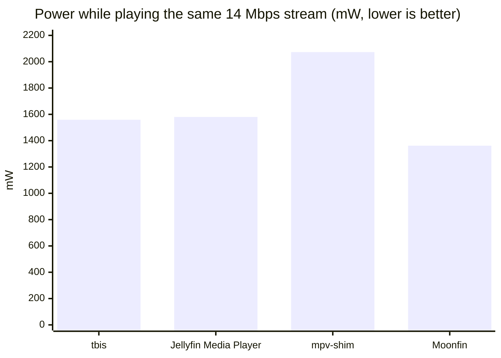
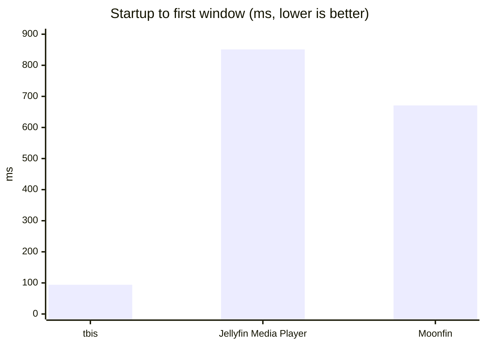
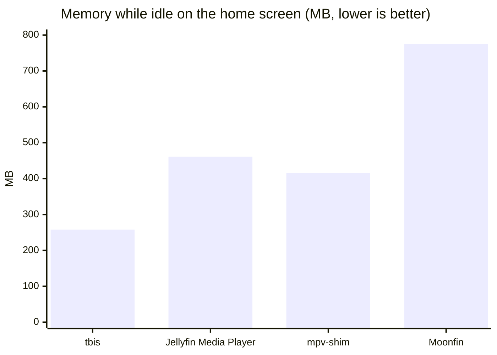

# tbis

A native macOS client for [Jellyfin](https://jellyfin.org), built with [GPUI](https://gpui.rs) and playing video through an embedded [mpv](https://mpv.io).

## Install

With [Homebrew](https://brew.sh), which also handles the Gatekeeper step below:

```sh
brew install --cask mahi160/tbis/tbis
```

Or by hand:

1. Download the latest `tbis-*-macos-arm64.zip` from [Releases](https://github.com/mahi160/tbis/releases). It needs an Apple Silicon Mac running macOS 11 or later.
2. Unzip it and move `tbis.app` to your Applications folder.
3. Open it once. macOS will say it can't check the app for malicious software, because tbis isn't signed with an Apple Developer ID yet. To allow it, do one of the following:
   - Open **System Settings → Privacy & Security**, scroll down to the message about tbis, and click **Open Anyway**.
   - Or run this in Terminal:

     ```sh
     xattr -dr com.apple.quarantine /Applications/tbis.app
     ```

You only need to do this once. The app bundles everything it needs, including mpv, so you don't need Homebrew.

## Updates

tbis checks for a newer release each time it starts, and you can check yourself with **Check for Updates…** in the user menu. When you accept an update, tbis downloads it, checks it against the checksum GitHub records for the release, replaces the app, and restarts. Updates installed this way don't need the Gatekeeper step again. If tbis is in a folder you can't write to, the update fails and you can download it from Releases instead.

## Performance

### Compared with other Jellyfin clients

tbis 0.4.0 against Jellyfin Media Player 1.12.0, jellyfin-mpv-shim 3.2.0, and Moonfin 2.7.0, measured in October 2026 on a MacBook Air M4 (16 GB, macOS 27.2, plugged in).

The test movie was *Men in Black* (1997), a 67 Mbps 4K HEVC Dolby Vision file with TrueHD Atmos audio. With default settings, only tbis played it directly. The server converted it to a 14 Mbps H.264 stream for the other clients. To compare like with like, tbis was also measured playing that same converted stream.







| | tbis | Jellyfin Media Player | mpv-shim | Moonfin |
|---|---|---|---|---|
| Plays the 4K file directly | yes | no | no | no |
| CPU while playing | 24% | 35% | 25% | 11% |
| CPU while idle | 2.3% | 1.7% | 0.3% | 32% |

Playing the original 4K file, tbis used 32% CPU and the Mac drew 1918 mW.

**Verdicts.**

- **tbis** is the only one that played the 4K Dolby Vision file directly. It started about 7 to 9 times faster than the others and used the least memory at idle. On the same stream it used about 30% less CPU than Jellyfin Media Player.
- **Jellyfin Media Player** idles well, but it used the most CPU while playing, and it can't play this file directly.
- **mpv-shim** idles the lightest. While it played, the Mac drew the most power, and this test doesn't show why.
- **Moonfin** plays the most efficiently, because on macOS it hands video to Apple's AVPlayer (through [AetherEngine](https://github.com/superuser404notfound/AetherEngine)) instead of mpv. That comes from the video engine, not from Flutter. Its home screen is the heaviest: it kept the GPU about 83% busy while idle.

<details>
<summary>How it was measured</summary>

Each client's whole process tree was sampled once a second, for 3 minutes of playback from 10:00 after a 15-second warm-up, and for 60 seconds idle on the home screen. CPU and memory come from `top`. Power covers the CPU and GPU of the whole Mac and comes from `powermetrics`. Each run was done once, so differences of a few percent are noise. The server's conversion work isn't counted. Jellyfin Desktop 2.0 was installed but not measured.

</details>

### Compared with Photon

This compares tbis with Photon during playback of the same movie, fullscreen, on macOS. Each app was sampled once for 60 seconds with `top -l 31 -s 2`, and only the main process was measured.

| Metric | tbis | Photon |
|---|---|---|
| CPU average | 10.7% | 37.1% |
| CPU peak | 28.7% | 101.7% |
| Energy Impact average | 10.7 | 37.3 |
| Memory footprint | 1385 MB | 409 MB |
| Resident memory (RSS) | 247 MB | 277 MB |
| Threads | 27 | 44 |

These numbers are rough. Energy Impact is an estimate from macOS, not a measurement in watts. The run did not confirm that both apps used the same codec, resolution, or hardware decoding. tbis had been running for a while before the test, so its memory footprint may include cached images.

## Build from source

You need Rust and Homebrew's mpv (`brew install mpv`).

```sh
cargo run --release         # run straight from the build
sh scripts/bundle.sh        # build a self-contained target/tbis.app
```

## Releases

Pushing to the `prod` branch builds and publishes a release through GitHub Actions (`.github/workflows/release.yml`). The version is bumped from the commit messages since the last release:

- a breaking change (`feat!:` or `BREAKING CHANGE`) bumps the major version
- any `feat:` commit bumps the minor version
- anything else bumps the patch version

The first release has no earlier tag to bump from, so it uses the version in `Cargo.toml` as is.

## License

tbis is licensed under the [GNU General Public License v3.0 or later](LICENSE). The app bundles GPL builds of mpv and FFmpeg (see [ADR-0004](docs/adr/0004-bundle-libmpv-and-license-as-gpl.md)). Each release includes a `sources` archive with the source code of tbis and of every bundled library, and the app carries their license files in `tbis.app/Contents/Resources/licenses`.
